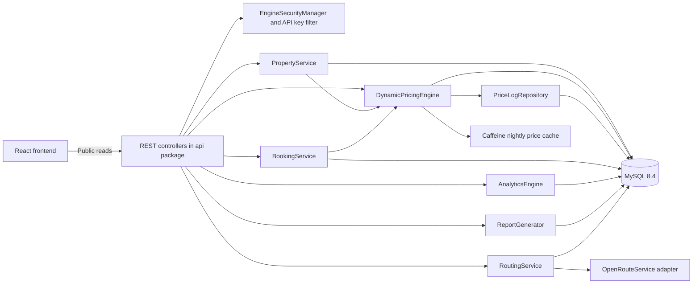
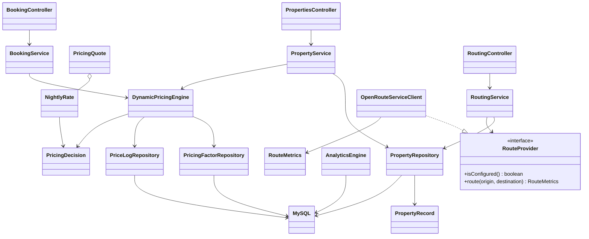
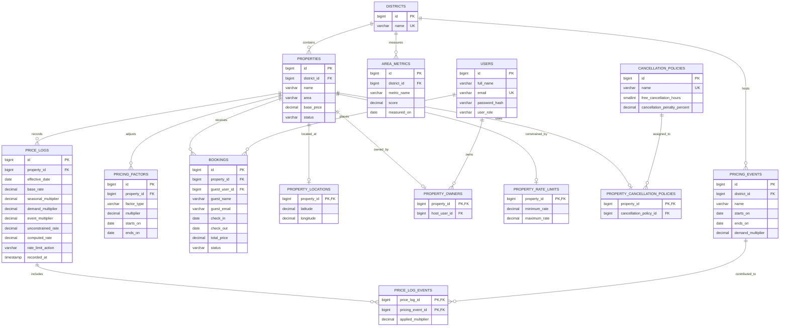
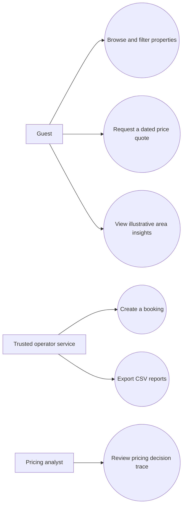

# Engine Architecture

## Components



The web frontend consumes the public property API. The database and shared server API key stay on the backend. Booking and report routes require a bearer key and must be called by a trusted server, not directly by browser code.

## Service class model



Controllers form the HTTP presentation boundary; service classes own business rules; repositories use JDBC for MySQL access. The routing provider interface keeps the rest of the engine independent of OpenRouteService and allows a different routing implementation to be substituted later.

## Source layout

```text
src/                                      React presentation tier
    routes/                                 Home, listings, settings, insights, engine dashboard
    lib/markham-api.ts                      Browser-safe public API client
engine/src/main/java/bw/markham/engine/
    api/                                    REST controllers and API errors
    analytics/, booking/, pricing/          Business services and domain types
    property/, report/, routing/            Business services and JDBC repositories
    config/, security/                      Cross-cutting engine concerns
engine/src/main/resources/schema.sql      MySQL data tier, constraints, indexes, seed data
engine/docs/                              ERD, UML and requirements traceability
src/routes/engine.tsx                     Operator dashboard for live traces and recent decisions
```

## Entity relationships



`total_price` is a booking-time snapshot; it does not depend on later pricing-factor changes. Booking creation locks the property row, checks date overlap, calculates the quote, and inserts within one transaction.

## Use cases



Public use cases are read-only. Booking, report delivery, user identity, property administration, payment, and cancellation workflows require production authentication and authorization design before deployment.

The optional OpenRouteService adapter accepts an origin coordinate from a trusted caller and joins it to the property's stored destination coordinate. It returns routed distance and travel duration; the API key remains in engine configuration and is never sent to the browser. Seed coordinates are illustrative and must be replaced with verified property coordinates.